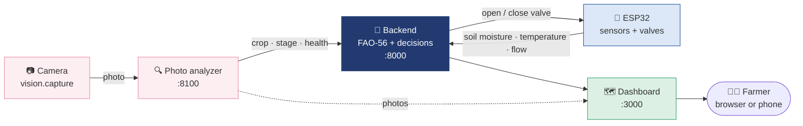

<div align="center">

<sub>Kizuna_Hackathon_Agriwize</sub>

# 絆 AGRIWISE

### Smart irrigation for Tunisian farmers — camera · sensors · FAO‑56

**KIZUNA 2026** · water · energy · agriculture

`Dashboard :3000` &nbsp;·&nbsp; `Backend :8000` &nbsp;·&nbsp; `Photo analyzer :8100`

</div>

---

## 🌊 The system at a glance



| Port | Service | Folder | What it does |
|:---:|---|---|---|
| **3000** | 🗺️ **Dashboard** | `kizuna-dashboard` | The farmer's screen: farm map, plot detail, camera procedure |
| **8000** | 🧠 **Backend** | `kizuna-backend` | Water calculation (FAO‑56), decisions, ESP32 link, history |
| **8100** | 🔍 **Photo analyzer** | `kizuna-vision` | Recognises crop, stage, health, sticky-trap insects, rain, movement |

> [!NOTE]
> One single Python environment is used for everything: **`kizuna-backend\.venv`**.
> Both `.env` files (`kizuna-backend\.env` and `kizuna-vision\.env`) must contain **the same `DEVICE_API_KEY`**.

---

## 🚀 Start — option A: one double-click

In `C:\Users\amine\Documents\kizuna`:

| | File | Effect |
|:---:|---|---|
| ▶️ | **`start-agriwise.bat`** | Opens the 5 windows in the right order, then the dashboard in your browser |
| ⏹️ | **`stop-agriwise.bat`** | Closes all AGRIWISE windows |

Settings at the top of `start-agriwise.bat` (right-click → *Edit*):

| Setting | Default | Meaning |
|---|:---:|---|
| `USE_SIMULATOR` | `1` | `1` = simulated ESP32 · `0` = the real ESP32 sends its own data |
| `USE_CAMERA` | `1` | `0` = do not start the camera |
| `CAMERA` | `0` | `0` = first webcam, `1` = second… or a stream address (ESP32‑CAM, IP camera) |
| `CAMERA_ZONE` | `2` | Plot filmed by the camera |
| `CAMERA_EVERY` | `1` | Minutes between two photos (1 for the demo, 30–60 on a real farm) |

---

## 🛠️ Start — option B: by hand, 5 terminals

Open one **PowerShell** window per step, **in this order**, and leave them open.

### ① Backend — port 8000 &nbsp;`always first`

```powershell
cd C:\Users\amine\Documents\kizuna\kizuna-backend
.\.venv\Scripts\Activate.ps1
uvicorn app.main:app --host 0.0.0.0 --port 8000
```
✅ Ready when you see `Uvicorn running on http://0.0.0.0:8000`

### ② Photo analyzer — port 8100

```powershell
cd C:\Users\amine\Documents\kizuna\kizuna-vision
..\kizuna-backend\.venv\Scripts\Activate.ps1
uvicorn vision.service:app --host 0.0.0.0 --port 8100
```

### ③ Dashboard — port 3000

```powershell
cd C:\Users\amine\Documents\kizuna\kizuna-dashboard
..\kizuna-backend\.venv\Scripts\Activate.ps1
python server.py --port 3000
```
✅ Prints `AGRIWISE dashboard: http://localhost:3000`. If a port is blocked by Windows, it switches to a free one by itself and prints the address to use.

### ④ ESP32 — simulated &nbsp;`skip it with the real ESP32`

```powershell
cd C:\Users\amine\Documents\kizuna\kizuna-backend
.\.venv\Scripts\Activate.ps1
python tools\esp32_simulator.py --api http://localhost:8000 --key YOUR_KEY
```
`YOUR_KEY` = the value of `DEVICE_API_KEY` in `kizuna-backend\.env`
(show it with `Select-String -Path .env -Pattern DEVICE_API_KEY`).

<details>
<summary>More simulator options</summary>

| Option | Example | Effect |
|---|---|---|
| `--interval` | `--interval 10` | Seconds between two readings (default 5) |
| `--blocked-zone` | `--blocked-zone 0` | Valve channel 0 only gets 40 % of its water → shows the "water not delivered" alert |

</details>

### ⑤ Camera

```powershell
cd C:\Users\amine\Documents\kizuna\kizuna-vision
..\kizuna-backend\.venv\Scripts\Activate.ps1
python -m vision.capture --camera 0 --zone 2 --source mast --every 1
```

<details>
<summary>More camera options</summary>

| Option | Example | Effect |
|---|---|---|
| `--camera` | `--camera 1` or `--camera http://192.168.1.50:81/stream` | Which webcam or stream |
| `--zone` | `--zone 3` | Plot filmed |
| `--every` | `--every 30` | Minutes between photos |
| `--source` | `--source trap` | `mast` (fixed camera), `carriage`, `trap` (yellow sticky trap) |
| `--image` | `--image photo.jpg --zone 2` | Analyse one picture and exit |

</details>

> [!TIP]
> To stop a window: **Ctrl + C**.

---

## 🧭 Where to look

| Address | Page | For |
|---|---|---|
| **http://localhost:3000** | 🗺️ **Farm map** | Every plot, the water network, problems marked with a badge — touch a plot for the detail |
| http://localhost:3000/zone.html | 🌱 Plot | Status banner, live system diagram, irrigation cycle, camera, sensors, chart |
| http://localhost:3000/camera.html | 📷 Camera | The cameras and the 8 analysis steps of each photo, stage confirmation |
| **http://localhost:8100** | 🔍 Analyzer | What each analysis module can do, and a photo test (drag & drop) |
| http://localhost:8000/docs | ⚙️ API | Every backend endpoint, to test by hand |

Every value on screen says where it comes from: **mesuré** · **calculé** · **prévision** · **IA** · **indice IA** · **manquant**.

---

## 📱 Open it on a phone

1. Phone and PC on the **same Wi‑Fi**.
2. Services started with `--host 0.0.0.0` (as above).
3. On the PC: `ipconfig` → note the **IPv4 address** (e.g. `192.168.1.20`).
4. On the phone: **`http://192.168.1.20:3000`** — the pages find the backend and the analyzer by themselves.

> [!IMPORTANT]
> The first time, Windows asks whether Python may use the network: click **Allow**.

---

## 🌤️ Once, when online

Run these two calls from http://localhost:8000/docs (*Try it out* → *Execute*):

| Call | Why |
|---|---|
| `POST /api/weather/refresh` | 7-day forecast (ET0, rain) — the scheduler then refreshes it by itself |
| `POST /api/climate/refresh` | 5 years of local temperatures → degree-days to correct the crop stages |

> [!NOTE]
> Open-Meteo is free up to 10 000 calls per day **per internet connection**. On a shared Wi‑Fi the limit can be reached by others: try again later or from a phone hotspot. Without these data the system keeps working and says what it is missing.

---

## 🎬 5-minute demo for the jury

| # | Show | Where |
|:---:|---|---|
| 1 | The farm map: plots, water network, the ESP32 sending data | `:3000` |
| 2 | A plot under irrigation: water flowing, cycle on *Irriguer* | Map → touch the plot |
| 3 | A problem: run the simulator with `--blocked-zone 0` → red badge + "what to do" | Map |
| 4 | A photo analysed step by step, crossed with the sensors | `:3000/camera.html` or `:8100` |
| 5 | Confirm a stage → Kc, root depth and the irrigation plan change | Camera page → *Confirmer* |
| 6 | The emergency stop closes every valve | Red button at the top |

---

## 🩺 Troubleshooting

| You see | Cause | Fix |
|---|---|---|
| `local safe mode: valves closed` in the ESP32 window | The backend is not running | Start ① — the ESP32 reconnects by itself |
| Dashboard: *Pas de connexion au backend* | Same | Start ① and check http://localhost:8000/health |
| `WinError 10013` | Windows reserves that port | Dashboard: switches by itself. Backend/analyzer: send the error to change the port |
| `401 Unauthorized` | The two `DEVICE_API_KEY` differ | Same value in both `.env` files (no `#` comment on the same line), then restart ① and ② |
| `python` not recognised | Environment not activated | `..\kizuna-backend\.venv\Scripts\Activate.ps1` first |
| No photo on the dashboard | ② or ⑤ not running, or wrong `--camera` | Look at the camera window; try `--camera 1` |
| *ESP32 hors ligne* on the map | ④ (or the real ESP32) not sending | Start ④, check the key |
| Old look after an update | Browser cache | **Ctrl + F5** |
| *Daily API request limit exceeded* | Open-Meteo quota of the connection | Retry tomorrow or from a hotspot |

---

## 📁 Folders

```
kizuna/
├── README.md               ← this file
├── start-agriwise.bat      ← start everything
├── stop-agriwise.bat       ← stop everything
├── kizuna-backend/         🧠 API · FAO-56 · decisions · ESP32     (port 8000)
│   ├── .env                   settings + DEVICE_API_KEY
│   ├── .venv/                 the Python environment used by everything
│   ├── kizuna.db              the farm's data
│   └── tools/esp32_simulator.py
├── kizuna-vision/          🔍 photo analyzer                        (port 8100)
│   ├── .env                   same DEVICE_API_KEY
│   └── images/                analysed photos
└── kizuna-dashboard/       🗺️ farmer's screen                       (port 3000)
    ├── server.py
    └── web/
```

## ✅ Tests

```powershell
cd kizuna-backend   ; python -m pytest -q      # backend
cd ..\kizuna-vision ; python -m pytest -q      # analyzer
cd ..\kizuna-dashboard ; python -m pytest -q   # dashboard
```

---

<div align="center">

**絆 — the bond between the farmer, the water and the plant.**

AGRIWISE · KIZUNA 2026

</div>
